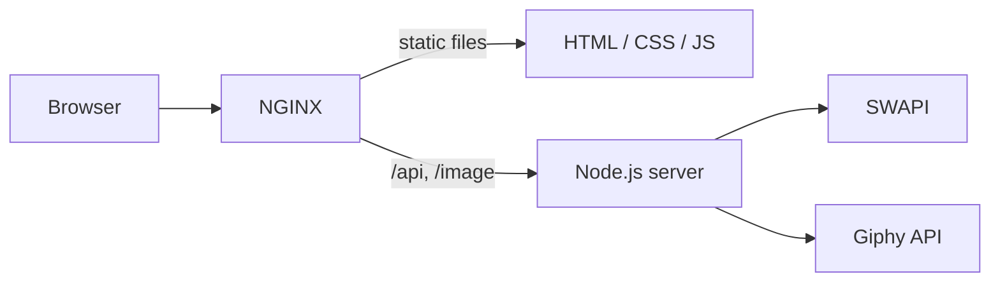

# Web Development

Four practical projects from the **Web Concepts** course. They grow step by step: a client-side app that consumes a public REST API turns into a containerised Node.js service behind an NGINX reverse proxy, with JWT authentication and unit tests.

| Project | What it shows | Stack |
| --- | --- | --- |
| [Star Wars Explorer](./01-star-wars-explorer) | Consuming a paginated REST API, building UI with the DOM API, responsive layout | HTML, CSS, JavaScript |
| [Drawing App](./02-drawing-app) | Canvas API, tool state, undo history | HTML, CSS, JavaScript, Canvas |
| [Star Wars Server](./03-nginx-node-server) | Server-side API calls, hiding API keys, reverse proxy, Docker | Node.js, NGINX, Docker, Giphy API |
| [Star Wars Server with Auth](./04-jwt-auth-and-tests) | JWT authentication, SQLite, unit testing | Node.js, JWT, SQLite, Jest |

---

## 1. Star Wars Explorer

A responsive web page that lists planets and characters from the Star Wars universe using [SWAPI](https://swapi.dev/), styled in a Star Wars look.

- Fetches data with `async/await` and renders every element through the DOM API, without HTML templates in strings
- Previous and next page navigation over the API’s paginated results
- Resolves related resources (for example, the residents of a planet) and shows them with each item
- Handles loading and network errors without console errors
- Works on mobile, tablet and desktop

**Run:** open `index.html` in a browser.


## 2. Drawing App

A small paint app built on the HTML Canvas.

- **D** – draw with the pencil, **E** – erase, **↺** – undo the last stroke, **C** – clear the canvas
- Adjustable pencil size and colour
- Undo keeps a history of canvas states, so each stroke can be reverted
- Stamp tool that places a predefined monochrome image on the canvas

**Run:** open `index.html` in a browser.


## 3. Star Wars Server

The Star Wars Explorer rebuilt as a server-driven application. The browser only talks to its own origin; all calls to external APIs happen on the server, so API keys never reach the client.



- NGINX serves the static front end and proxies API requests to Node.js
- Every item in the API response includes an `animated_image` field
- `/image/<title>` endpoint searches Giphy by title and returns an animated GIF for each item
- NGINX and Node.js packaged together with a Dockerfile

**Run:**

```bash
cd 03-nginx-node-server
docker build -t star-wars-server .
docker run -p 8080:80 -e GIPHY_API_KEY=your_key star-wars-server
```

Then open http://localhost:8080. A Giphy API key is free at [developers.giphy.com](https://developers.giphy.com/).

## 4. Star Wars Server with Auth

Project 3 extended with user authentication and unit tests.

- `/auth` endpoint checks the login and password against a SQLite database and issues a JWT
- Protected endpoints accept requests only with a valid `Authorization: Bearer <token>` header
- Unauthenticated users see only a login form; wrong credentials return a readable error message
- Core logic split into separate functions covered by Jest unit tests

**Run:**

```bash
cd 04-jwt-auth-and-tests
docker build -t star-wars-auth .
docker run -p 8080:80 -e GIPHY_API_KEY=your_key -e JWT_SECRET=any_secret star-wars-auth
```

Open http://localhost:8080 and sign in with the test user: login `user`, password `pass`.

**Tests:**

```bash
npm install
npm test
```
